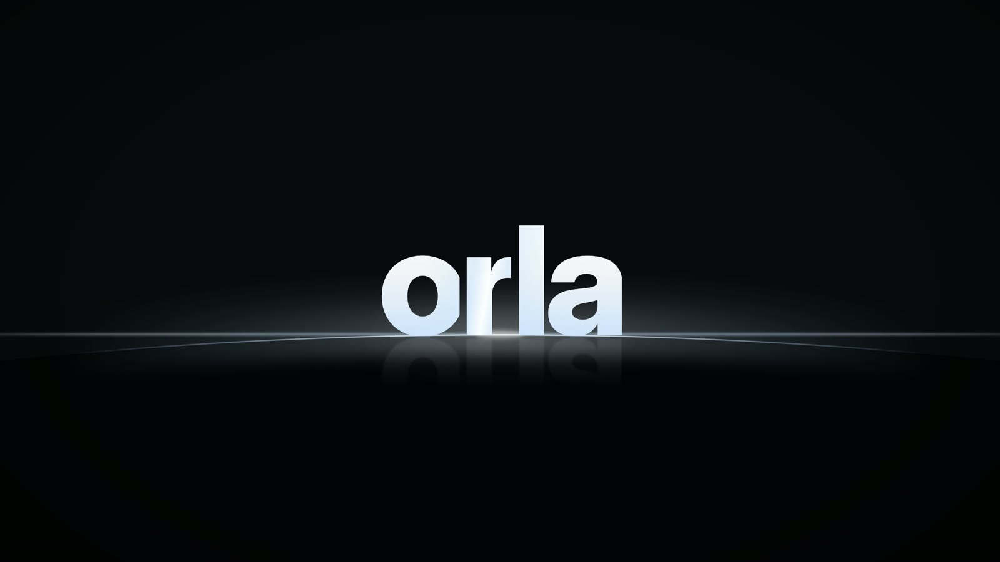

<p align="center"></p>

<h1 align="center">orla</h1>

<p align="center"><b>Uma tela inicial limpa, rápida e bonita para a sua TV.</b><br>
Sem anúncios. Seus apps, o que está em alta e a TV ao vivo, num só lugar.</p>

---

## O que é

A **orla** substitui a tela inicial da sua Fire TV. Em vez de uma tela cheia de
propagandas e sugestões que você não pediu, você vê:

- **Seus apps** numa barra no rodapé, na ordem que você escolher.
- **O que está em alta** nos filmes e nas séries, com capa, sinopse e um botão
  **"Abrir no Netflix"** (ou no app onde o título está disponível).
- **Detalhes** de cada título: elenco, notas, trailer, temporadas e onde assistir.
- **TV ao vivo**, clima, relógio e atalhos para as configurações da TV.
- Uma **abertura** curta quando a TV liga.

Ela é grátis, é sua e não envia nada para nenhum servidor nosso: não existe servidor.

> A orla organiza e abre os apps que você já tem. Ela **não** traz filmes, assinaturas
> ou acesso grátis a serviços de streaming.

## Funciona na minha TV?

| Aparelho | Situação |
|---|---|
| **Fire TV Stick 4K** (Fire OS 8) | ✅ Testado e funcionando |
| Outros Fire TV com Fire OS | Deve funcionar, ainda não testado |
| Google TV / Android TV | Em breve |
| LG (webOS), Samsung (Tizen), Fire TV com Vega OS | Ainda não. Uma saída é ligar um Fire TV Stick na TV |

Detalhes em [COMPATIBILITY.md](COMPATIBILITY.md).

## O que você precisa

- A **Fire TV** e um **computador** (Windows, Mac ou Linux) **na mesma rede Wi-Fi**.
- Uns **20 minutos** na primeira vez.
- Programas no computador (todos grátis). São usados só para instalar:
  - **Java JDK 17** ou mais novo: [Adoptium](https://adoptium.net/)
  - **Node.js 20** ou mais novo: [nodejs.org](https://nodejs.org/)
  - **Android SDK** (platform 34, build-tools 34) e **ADB**: o jeito mais simples é
    instalar o [Android Studio](https://developer.android.com/studio) uma vez
  - **Git**, para baixar o projeto: [git-scm.com](https://git-scm.com/)
- **Opcional:** uma chave grátis do [TMDB](https://www.themoviedb.org/) para ver os
  filmes e séries em alta, e uma do [MDBList](https://mdblist.com/) para as notas do IMDb
  e do Rotten Tomatoes. Sem elas, a barra de apps e o resto funcionam normalmente.

> Não quer instalar nada disso? Peça a um assistente de IA no computador (como o
> [Claude Code](https://claude.com/claude-code)): *"Instale a orla na minha Fire TV,
> IP 192.168.0.50"*. O projeto tem instruções para ele no arquivo `AGENTS.md`.

## Como instalar

### 1. Prepare a Fire TV

1. Na TV, abra **Configurações → Minha Fire TV → Sobre**.
2. Clique **7 vezes** no nome do aparelho, até aparecer *"Você agora é um desenvolvedor"*.
3. Volte e abra **Opções do desenvolvedor → Depuração ADB → Ligado**.
4. Anote o **endereço IP**: **Configurações → Minha Fire TV → Sobre → Rede**
   (algo como `192.168.0.50`).

### 2. Baixe a orla no computador

```bash
git clone https://github.com/FabioMatheusDev/orla-os.git
cd orla-os
```

### 3. Instale

Troque `192.168.0.50` pelo IP da sua TV.

**Windows** (PowerShell):
```powershell
.\scripts\install.ps1 -Ip 192.168.0.50
```

**Mac / Linux** (Terminal):
```bash
chmod +x gradlew scripts/*.sh
./scripts/install.sh 192.168.0.50
```

Na primeira vez, a TV pergunta **"Permitir depuração USB?"**. Marque **"Sempre permitir
deste computador"** e confirme. O script continua sozinho.

### 4. Pronto

Aperte o **botão Home** do controle: a orla aparece. A tela da Amazon pode piscar por um
instante antes, isso é normal.

### 5. (Opcional) Coloque suas chaves

Para ver filmes e séries em alta: no controle, aperte **☰ → Catálogo e chaves** e digite
sua chave do TMDB (e a do MDBList, se tiver). Elas ficam guardadas **só na sua TV**,
protegidas.

> **Como pegar a chave do TMDB:** crie uma conta grátis em themoviedb.org, abra
> **Configurações → API → Criar → Developer**, preencha o formulário (uso pessoal)
> e copie a **Chave da API**.

## Como usar

| Quero... | Faça assim |
|---|---|
| Abrir um app | Desça até a barra e aperte **OK** |
| Mudar a ordem dos apps | **Segure OK** num app e use **← →**. **OK** salva, **Voltar** cancela |
| Ver apps que não estão na barra | Passe o app pelo card **Todos**, ou segure **OK** no **Todos** |
| Ver todos os apps e a TV ao vivo | Card **Todos** na barra |
| Ver detalhes de um filme ou série | **Detalhes**, no destaque ou em qualquer capa |
| Mudar o visual | **☰ → Visual**: *Vidro* (bonito) ou *Sólido* (mais rápido) |
| Desligar os sons ou a abertura | **☰ → Sons da interface** / **Abertura ao ligar a TV** |
| Abrir as configurações da TV | Ícone de engrenagem no topo |

> Se a navegação parecer lenta, use o visual **Sólido**: no Fire TV Stick ele fica bem
> mais fluido.

## Como desfazer

A tela da Amazon nunca é apagada nem desativada. Para voltar ao normal:

- **Pela TV:** **☰ → Restaurar tela original do Fire TV**.
- **Pelo computador:** `.\scripts\restore.ps1 -Ip SEU_IP` (Windows) ou
  `./scripts/restore.sh SEU_IP` (Mac/Linux). Para também desinstalar a orla, acrescente
  `-Uninstall` (Windows) ou `--uninstall` (Mac/Linux).

## Perguntas frequentes

**É pirataria?** Não. A orla só mostra o que está em alta e abre os apps que você já
assina.

**Mexe em alguma coisa da minha TV?** Ela instala o app e liga um serviço de acessibilidade
que só percebe quando a tela inicial da Amazon aparece, para trazer a orla de volta. Ela
não lê o que está na tela, não desativa apps e não muda a rede, a imagem ou o som.

**Minhas chaves estão seguras?** Elas ficam cifradas na própria TV e não vão para nenhum
servidor nem para este repositório.

**Como atualizo?** Baixe a versão nova (`git pull`) e rode o mesmo comando de instalação.
Suas chaves, favoritos e a ordem da barra continuam.

**Preciso deixar o computador ligado?** Não. Ele só é usado para instalar.

**A TV ao vivo não aparece.** Ela só aparece quando a TV tem um app de TV ao vivo, como
o Live TV da Amazon ou o Live Channels do Google.

## Para desenvolvedores

Como compilar, testar, a estrutura do código, a segurança das chaves e como a abertura
é gerada: [DEVELOPMENT.md](DEVELOPMENT.md). Para adaptar a orla a outras TVs, veja o
[kit de ports](ports/README.md).

## Créditos

Baseada no [Free My TV](https://github.com/simbasjungles/free-my-tv), licença MIT,
preservada em [LICENSE](LICENSE). Avisos de terceiros em
[THIRD_PARTY_NOTICES.md](THIRD_PARTY_NOTICES.md).

Dados de filmes e séries: [TMDB](https://www.themoviedb.org/). Onde assistir: JustWatch,
via TMDB. Notas: [MDBList](https://mdblist.com/).
*This product uses the TMDB API but is not endorsed or certified by TMDB.*
