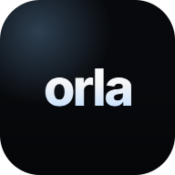
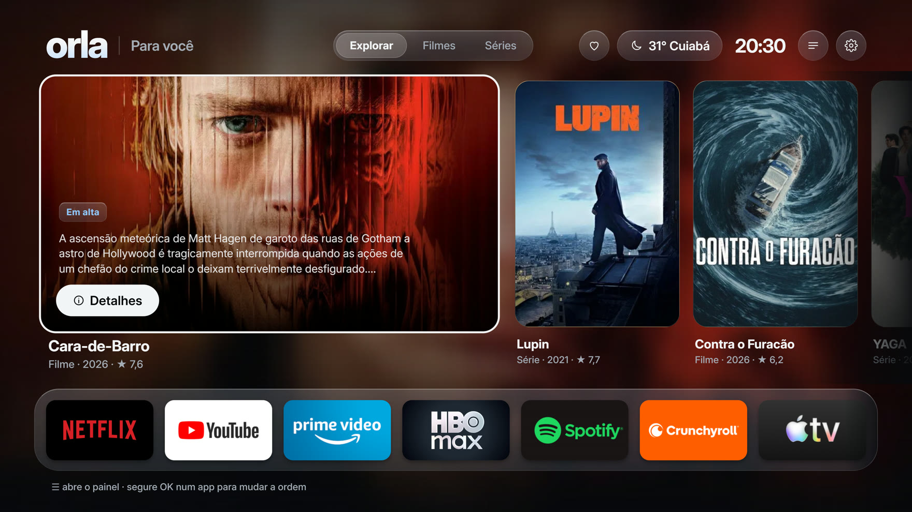

<div align="center">



# orla

**Uma tela inicial rápida, bonita e sem anúncios para a sua TV.**

Seus apps, o que está em alta nos filmes e séries, a TV ao vivo e o clima, num só lugar.<br>
Grátis e open source. Instalada pelo seu agente de IA. Um botão para desfazer.

[Instalar](#instale-com-seu-agente-de-ia) · [Desempenho](#desempenho) · [Qualquer TV](#funciona-em-qualquer-tv) · [Como usar](#como-usar) · [Vídeo](.github/orla-launch.mp4)



</div>

## O que você ganha

- **Sem anúncios.** Nada de fileiras patrocinadas, banners ou trailers que tocam sozinhos. Nenhum.
- **Muito mais fluida.** Até **8× menos engasgos** que a tela inicial original e quadros
  **quase 3× mais rápidos**, no visual Sólido. [Veja os números](#desempenho).
- **Feita para TVs que já travam.** Se a sua TV ou o seu stick ficou lento com o tempo, o
  visual **Sólido** foi pensado para hardware fraco: sem efeitos pesados, com folga para 60 fps.
- **Seus apps na frente.** Os apps que você usa numa barra de vidro, com os banners de cada
  um. **Segure OK** num app para mudar a ordem; os que sobram ficam em "Outros apps".
- **Em alta, não patrocinado.** Os filmes e séries em alta do dia, com capa, sinopse e um
  botão **"Abrir no Netflix"** (ou no app onde o título está).
- **Cada título por inteiro.** Elenco, notas, trailer, temporadas e onde assistir.
- **TV ao vivo, clima e atalhos.** A TV ao vivo da sua TV, a previsão por hora e as
  configurações a um clique.
- **Do seu jeito.** Visual **Vidro** ou **Sólido**, sons da interface e uma abertura curta
  quando a TV liga, tudo ligável e desligável no controle.
- **Segura.** Sem root. Nada é desinstalado. Suas chaves ficam cifradas na própria TV, e
  nenhum servidor nosso existe para receber dados seus.

## Desempenho

A mesma navegação pelo controle (destaques e barra de apps, 3 rodadas), medida com as
ferramentas do próprio Android (`dumpsys gfxinfo` e `meminfo`):

| | Tela inicial da Amazon | **orla · Sólido** | orla · Vidro |
|---|---|---|---|
| Quadros atrasados | 65–80% | **8–10%** | 50–58% |
| Tempo típico por quadro | 19–21 ms | **7 ms** | 16–18 ms |
| Piores engasgos (1% mais lentos) | 93–200 ms | **25–34 ms** | 57–69 ms |
| Memória da tela inicial | 250 MB | **169 MB (−32%)** | 202 MB (−19%) |

<sub>Medido num Fire TV Stick 4K (2ª geração, 2 GB, Fire OS 8) em 24/10/2026. Para ficar
fluido, cada quadro precisa sair em até 16,7 ms (60 fps). No Fire OS a tela da Amazon continua
aberta por trás, então a economia de memória é da tela inicial, não do aparelho todo. Outras
TVs terão números diferentes; o visual Sólido é a escolha para aparelhos mais fracos.</sub>

## Instale com seu agente de IA

Uns 15 minutos. Você precisa da TV e de um computador na **mesma rede Wi-Fi**.

1. **No computador**, abra um agente de IA: [Claude Code](https://claude.com/claude-code),
   [Codex](https://openai.com/codex/), [Gemini CLI](https://github.com/google-gemini/gemini-cli)
   ou [Antigravity](https://antigravity.google/).
2. **Peça a instalação**, trocando pelos seus dados:
   > Baixe github.com/FabioMatheusDev/orla-os, leia o AGENTS.md e instale a orla na minha
   > TV. Minha TV é uma **Fire TV Stick 4K**, o IP dela é **192.168.0.50** e eu moro em
   > **São Paulo**.

   Ele baixa o projeto, instala as ferramentas que faltarem, adapta a orla para a sua TV
   se precisar, instala e pergunta antes de qualquer coisa importante.
3. **Na TV**, faça só o que ele pedir: ligar o modo desenvolvedor, aceitar o aviso
   *"Permitir depuração?"* (marque **Sempre permitir**) ou entrar na conta do fabricante.

**Você não precisa entender de programação.** Não sabe o IP da TV? Pergunte ao agente: ele
explica onde achar no menu da sua TV.

### As chaves (opcional, grátis)

Para ver o que está em alta, crie uma chave do [TMDB](https://www.themoviedb.org/) (e, para
as notas do IMDb e do Rotten Tomatoes, do [MDBList](https://mdblist.com/)). Depois, **no
controle da TV**, aperte **☰ → Catálogo e chaves** e digite. Elas ficam só na sua TV.
**Não cole as chaves no chat do agente.** Sem chaves, a barra de apps e o resto funcionam.

> **Chave do TMDB em 2 minutos:** crie uma conta em themoviedb.org, abra
> **Configurações → API → Criar → Developer**, preencha (uso pessoal) e copie a **Chave da API**.

<details>
<summary>Instalar sem agente (Fire TV)</summary>

Você vai precisar de Git, Java JDK 17+, Node.js 20+ e Android SDK (platform 34, build-tools
34) com ADB. Na Fire TV: Configurações → Minha Fire TV → Sobre → clique 7 vezes no nome do
aparelho → Opções do desenvolvedor → **Depuração ADB: Ligado**. Depois:

```bash
git clone https://github.com/FabioMatheusDev/orla-os.git && cd orla-os
./scripts/install.sh 192.168.0.50         # Mac/Linux (antes: chmod +x gradlew scripts/*.sh)
.\scripts\install.ps1 -Ip 192.168.0.50    # Windows (PowerShell)
```

Aceite **"Permitir depuração USB"** na TV, marcando **"Sempre permitir"**. Os passos das
outras TVs estão no [AGENTS.md](AGENTS.md).

</details>

## Funciona em qualquer TV

O guia do agente ([AGENTS.md](AGENTS.md)) segue as regras oficiais de cada fabricante e, quando
preciso, adapta a orla para a sua TV.

| TV ou aparelho | Como fica |
|---|---|
| **Fire TV** (Fire OS: Fire TV Stick, Cube, TVs Fire TV) | Pronta e testada: vira a tela do botão Home |
| **Google TV / Android TV** (Chromecast, TCL, Sony, Philips, Xiaomi…) | O mesmo app, com os atalhos da sua TV |
| **LG** (webOS) | App LG, instalado pelo Developer Mode da LG; fica a uma tecla do controle |
| **Samsung** (Tizen, 2017+) | App Samsung, pelo modo desenvolvedor; a TV pode ligar direto nela |
| **Fire TV com Vega OS** (modelos novos) | App Vega, pelo kit oficial da Amazon |
| **Outras** (Roku, VIDAA…) | O agente procura um caminho oficial; se não houver, sugere um Fire TV Stick ou Google TV no HDMI |

Só a Fire TV foi testada em aparelho real até agora; nas outras, o agente faz a adaptação na
hora. Detalhes em [COMPATIBILITY.md](COMPATIBILITY.md).

## Como usar

| Quero... | Faça assim |
|---|---|
| Abrir um app | Desça até a barra e aperte **OK** |
| Mudar a ordem dos apps | **Segure OK** num app e use **← →**. **OK** salva, **Voltar** cancela |
| Ver apps que não estão na barra | Passe um app pelo card **Todos**, ou segure **OK** no **Todos** |
| Ver todos os apps e a TV ao vivo | Card **Todos** na barra |
| Ver detalhes de um filme ou série | **Detalhes**, no destaque ou em qualquer capa |
| Deixar mais rápida | **☰ → Visual → Sólido** |
| Desligar os sons ou a abertura | **☰ → Sons da interface** / **Abertura ao ligar a TV** |
| Abrir as configurações da TV | Engrenagem no topo |

## Desfazer

Peça ao agente *"desfaça a instalação da orla"*: ele sabe o caminho de volta de cada TV. Na
Fire TV também dá pela própria TV, em **☰ → Restaurar tela original do Fire TV**. A tela
original nunca é apagada.

## O que ela muda

- Instala o app da orla. Na Fire TV, ela vira a tela do botão Home.
- Na Fire TV, liga um serviço de acessibilidade que só percebe quando a tela inicial da Amazon
  aparece, para trazer a orla de volta. Ele não lê o que está na tela. O Restaurar o desliga.
- Não desinstala nada, não desativa apps sem você autorizar e não mexe na rede, na imagem,
  no som nem na sua conta.

## Perguntas frequentes

**É pirataria?** Não. A orla organiza e abre os apps que você já tem e assina. Ela não traz
filmes, assinaturas ou acesso grátis a serviços de streaming.

**É seguro deixar um agente de IA mexer?** Ele roda comandos no seu computador e na TV,
sempre explicando antes. O guia proíbe factory reset, root e apagar apps do sistema, e exige
um jeito de desfazer cada mudança. Leia o que ele propõe antes de aceitar.

**Como atualizo?** Peça ao agente: *"atualize a orla na minha TV"*. Suas chaves, favoritos e
a ordem da barra continuam.

**Preciso deixar o computador ligado?** Não. Ele só é usado para instalar.

**A TV ao vivo não aparece.** Ela só aparece quando a TV tem um app de TV ao vivo, como o Live
TV da Amazon ou o Live Channels do Google.

## Para desenvolvedores

Como compilar e testar, a estrutura do código, a segurança das chaves e como a abertura e o
vídeo de lançamento são gerados em código: [DEVELOPMENT.md](DEVELOPMENT.md). Para adaptar a
orla a outras TVs, veja o [kit de ports](ports/README.md).

## Créditos

Baseada no [Free My TV](https://github.com/simbasjungles/free-my-tv), de licença MIT,
preservada em [LICENSE](LICENSE). Avisos de terceiros em
[THIRD_PARTY_NOTICES.md](THIRD_PARTY_NOTICES.md).

Filmes e séries: [TMDB](https://www.themoviedb.org/). Onde assistir: JustWatch, via TMDB.
Notas: [MDBList](https://mdblist.com/). As capas e os logos dos apps pertencem aos seus donos.
*This product uses the TMDB API but is not endorsed or certified by TMDB.*
